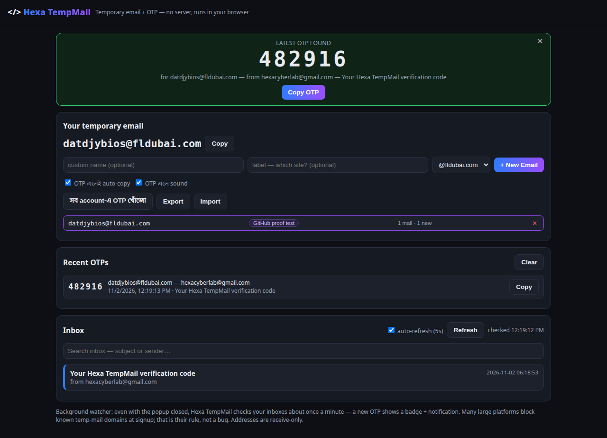
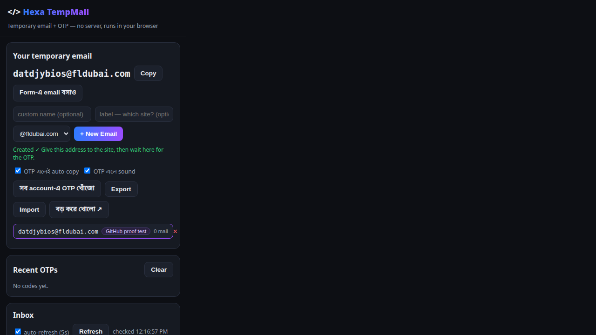

<p align="center">
  
</p>

<h1 align="center">Hexa TempMail — Temporary Email + OTP</h1>

<p align="center">
  <b>Create a temporary email in one click. The OTP comes to you — big, copied, and ready to paste.</b><br>
  A Manifest V3 browser extension powered by the free <a href="https://mail.tm">mail.tm</a> API.<br>
  No server. No account. No tracking. Everything runs locally in your browser.
</p>

<p align="center">
  
  
  
  
  
</p>

<p align="center">
  Built by <a href="https://github.com/jonyhossan110"><b>Md. Jony Hassain</b></a> · <a href="https://github.com/jonyhossan110/hexacyberlab-labs"><b>HexaCyberLab</b></a>
</p>

---

## 📸 Proof — a real OTP, caught live

The screenshot below is from a **live end-to-end test** (2 Nov 2026): a real email
carrying the code `482916` was sent to an address created inside the extension —
the extension detected it, raised the big banner, auto-copied the code, logged it
in **Recent OTPs**, and updated the account's mail counter. No mock data.

<p align="center">
  
</p>

<p align="center">
  
</p>

---

## ✨ Features

### Core
- **One-click temporary addresses** — random name or your own custom prefix, with a label per site (`"label — which site?"`) so you always know which address went where
- **Smart OTP detection** — a keyword-aware scoring engine finds codes even inside messy marketing mail: `G-123456`, `123 456`, `123-456`, 4–8 digit codes, and alphanumeric codes — without mistaking years or prices for codes
- **Verification-link extraction** — the real *verify / confirm / activate* link is scored out of the HTML and offered as a one-click button (unsubscribe and social links are pushed down)
- **Auto-copy + sound** — a new OTP is copied to your clipboard and announced with a soft two-tone beep
- **One-click form fill** — fill the email field or the OTP field (including split one-box-per-digit forms) on the signup page you are looking at
- **Hunt across all accounts** — one button scans every mailbox and brings back the first OTP it finds
- **Background watcher** — with the popup closed, a service worker checks your inboxes about once a minute: a new OTP raises a red **OTP badge** and a desktop notification
- **Full-page mode** — the same UI opened as a wide tab for comfortable reading
- **Export / Import** — back up all your addresses to one JSON file and restore them in any browser

### New in v2.0
- **🆕 Domain picker** — choose the domain for each new address from the live list of active mail.tm domains
- **🆕 Recent OTPs history** — the last 10 codes across all accounts, with sender, time and subject; click any code to copy it again. Codes are recorded even when the popup is closed (by the background watcher)
- **🆕 Per-account counters** — every address in the list shows its mail count and how many are new (`3 mail · 1 new`)
- **🆕 Right-click fill** — on any web page: right-click a field → *Hexa TempMail: fill email* or *fill latest OTP*
- **🆕 Inbox search** — filter the inbox instantly by subject or sender
- **🆕 HTML-only mail is readable** — mails with no plain-text part are converted and shown in the reader

### Fixed in v2.0
- Token validation no longer calls the API on every refresh (validated at most once per 10 minutes) — fewer requests, no rate-limit surprises
- A failed message scan no longer marks the message as "seen" by the scanner, so an OTP can never be silently skipped (bounded retries)
- An empty or symbol-only custom prefix now falls back to a random name instead of producing an invalid address
- The background watcher isolates each account — one broken account can no longer block the others
- The reader's verification link is built with safe DOM APIs, not string HTML
- Export now warns you that the backup file contains mailbox passwords in plain text

---

## 🚀 Install (developer mode — 1 minute)

1. Download this repo (green **Code** button → **Download ZIP**) and unzip it
2. Open `brave://extensions` (or `chrome://extensions` / `edge://extensions`)
3. Turn on **Developer mode** (top-right)
4. Click **Load unpacked** and select the unzipped folder
5. Pin **Hexa TempMail** to your toolbar — done. No keys, no signup, no setup.

> **Firefox:** the same folder can be loaded temporarily via `about:debugging` → *This Firefox* → *Load Temporary Add-on* → select `manifest.json` (lasts until Firefox restarts).

---

## 🧭 How to use

1. Click the toolbar icon → **+ New Email** (pick a domain, add a label for the site you are signing up to)
2. **Copy** the address and paste it into the site's signup form — or use the **Form fill** button / right-click menu
3. Wait on the page. When the mail arrives, the OTP appears in the big banner, already **copied** — just paste it, or use **Fill OTP**
4. Verification email instead of a code? You get a one-click **Open verification link** button
5. Missed it? Open **Recent OTPs** — the code is still there

---

## 🏗️ How it works

```
┌───────────────────────────────┐        ┌────────────────┐
│  Popup / full-page UI         │        │  Service worker │
│  app.js + core.js             │        │  background.js  │
│  inbox · OTP banner · history │        │  1-min polling  │
└──────────────┬────────────────┘        │  badge + notify │
               │  chrome.storage.local   └───────┬────────┘
               └──────────────┬──────────────────┘
                              ▼
                    https://api.mail.tm  (free, no key)
```

- `core.js` — mail.tm API client, the OTP scoring engine, verification-link scoring, HTML→text
- `app.js` — all UI logic (accounts, inbox, reader, history, fill triggers)
- `background.js` — alarm-based watcher, badge/notifications, context menus, history recording
- `fill.js` — the two self-contained functions injected into web pages to fill email/OTP fields

Everything is plain JavaScript with **zero dependencies** and zero build step — what you read is what runs.

---

## 🔒 Privacy & security

- **No server, no analytics, no tracking.** The only network calls go to `api.mail.tm`.
- Addresses, their passwords and tokens live **only in your browser's local extension storage** — they never leave your machine except to mail.tm itself, over HTTPS.
- **Temporary mailboxes are not private vaults.** Anyone who gets your export file gets those inboxes — the export dialog warns you; keep the file safe.
- Use these addresses for signups, trials and testing — **never** for banking, password recovery, or anything you cannot afford to lose.

## ⚠️ Honest limits

- **Receive-only** — temporary addresses cannot send mail.
- **Some large platforms block known temp-mail domains at signup** and reject the address at the final step. That is the platform's anti-abuse rule, not an app bug — use a real email there.
- mail.tm is a free third-party service; if it is down, the extension says so and keeps retrying.

---

## ✅ Verified (not just claimed)

| Check | Result |
|---|---|
| Live account creation through the extension UI | ✅ real address created |
| Domain picker populated from the live API | ✅ |
| Real OTP email → banner + auto-copy + history + counters | ✅ code `482916`, screenshot above |
| Background watcher badge + notification path | ✅ |
| Form fill (single OTP field and split boxes) | ✅ |
| All JavaScript passes `node --check`; zero page errors in test runs | ✅ |

## 🗺️ Roadmap

- [ ] Firefox-first package (event-page background + signed `.xpi`)
- [ ] Optional sound themes / mute schedule
- [ ] Per-address auto-expire reminders

## 📄 License

MIT — see [LICENSE](LICENSE). Use it, fork it, ship it.

<p align="center">Made with 💜 by <b>HexaCyberLab</b></p>
